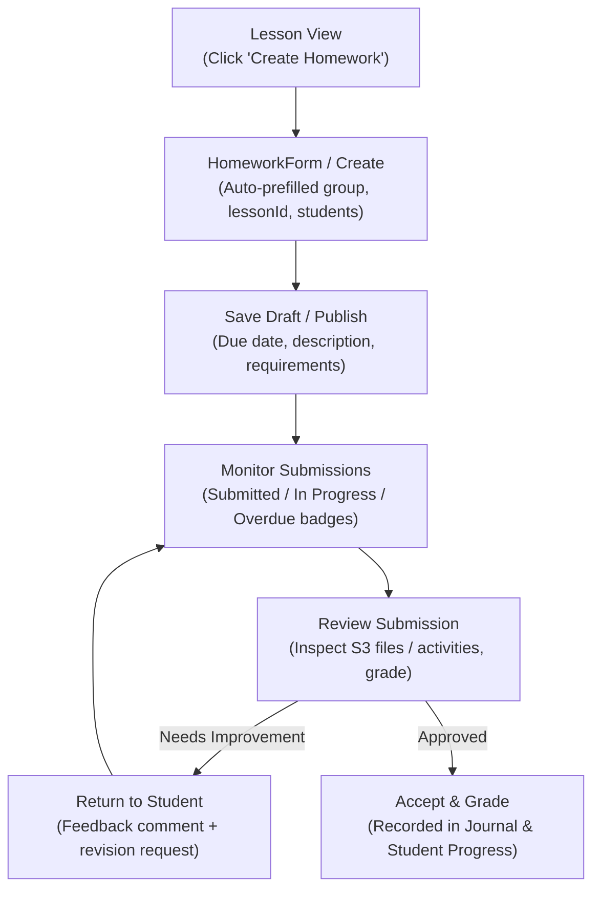
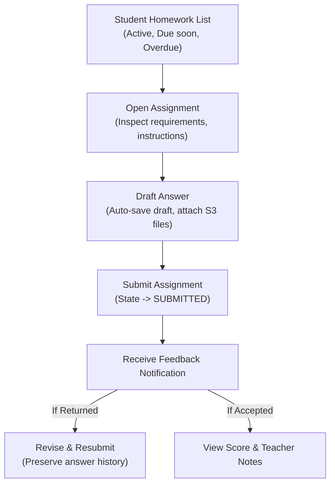
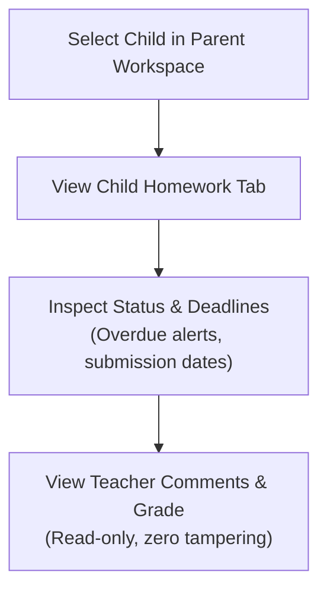

# EDUCATION_07 — Homework Product User Journey

## 1. Teacher End-to-End Workflow

### Steps:
1. **Context Hand-off from Lesson:**
   When a teacher is viewing a lesson at `/lessons/:id`, clicking "Create Homework" navigates to `/homework/new?lessonId=:id&groupId=:groupId`. The form pre-fills the title, group selection, and recipient student list from the lesson's roster.
2. **Assignment Configuration:**
   Teacher sets due date (`dueAt`), optional activity requirements (Typing / Logic tests), attachment guidelines, and maximum score.
3. **Publication:**
   Transition from `DRAFT` to `PUBLISHED`. Event dispatched to `education.notifications` for all assigned students and confirmed parents.
4. **Monitoring & Review Queue:**
   Teacher list view filters:
   - `ALL`, `DRAFT`, `PUBLISHED`, `CLOSED`, `ARCHIVED`.
   - Clear indicators: `SUBMITTED` (highlighted for urgent review), `OVERDUE` (red badge), `IN_PROGRESS`, `REVIEWED`.
5. **Review & Revision:**
   Teacher opens student answer via `HomeworkReviewView.vue`, inspects answer text and attached S3 files or interactive activity scores.
   - Action: **Accept** (state -> `REVIEWED`, score awarded).
   - Action: **Return** (state -> `RETURNED`, mandatory comment provided for student revision).

---

## 2. Student End-to-End Workflow

### Invariants:
1. **Draft Resilience:** Student answer draft is preserved locally and on the server (`POST /student/homework/:id/draft`).
2. **S3 File Attachments:** Student attaches documents via presigned S3 tickets (`HomeworkFileService.php`).
3. **No Double Submission:** Submit button is guarded with idempotency key and disabled while in-flight.
4. **Answer History:** If work was returned for revision, previous submissions and teacher comments are retained in `HomeworkAnswerHistory.vue`.

---

## 3. Parent End-to-End Workflow

### Invariants:
1. **Read-Only Access:** Parents can never edit, submit, or delete homework on behalf of the student.
2. **Context Isolation:** When a parent has multiple children, switching child in `ParentLayout.vue` completely re-fetches homework specific to that child's organization and student ID.
3. **Revocation Protection:** If the guardian link is revoked by the school administration, all parent homework requests immediately return 404/403.
