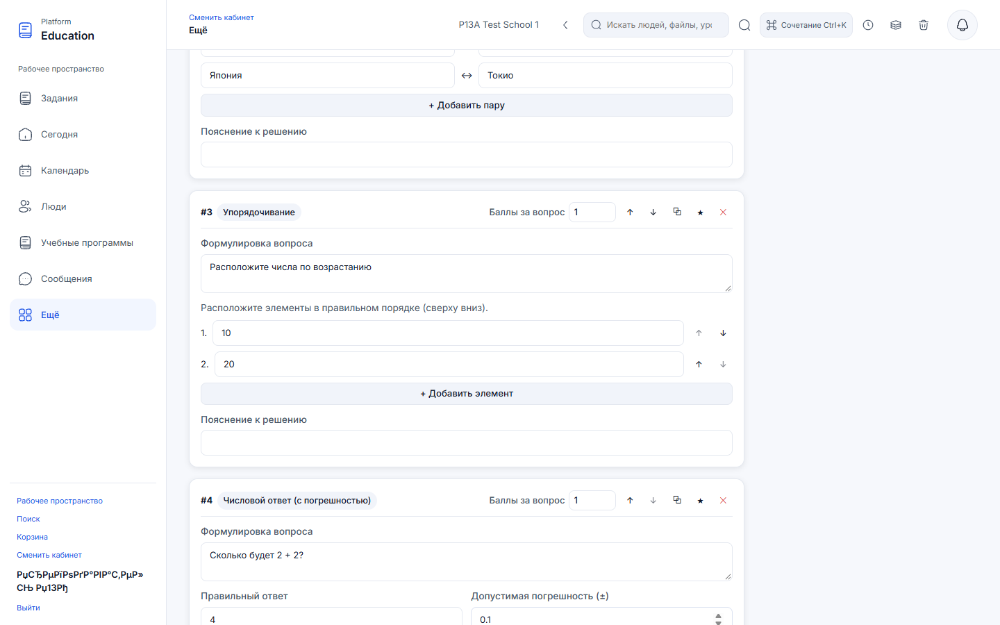
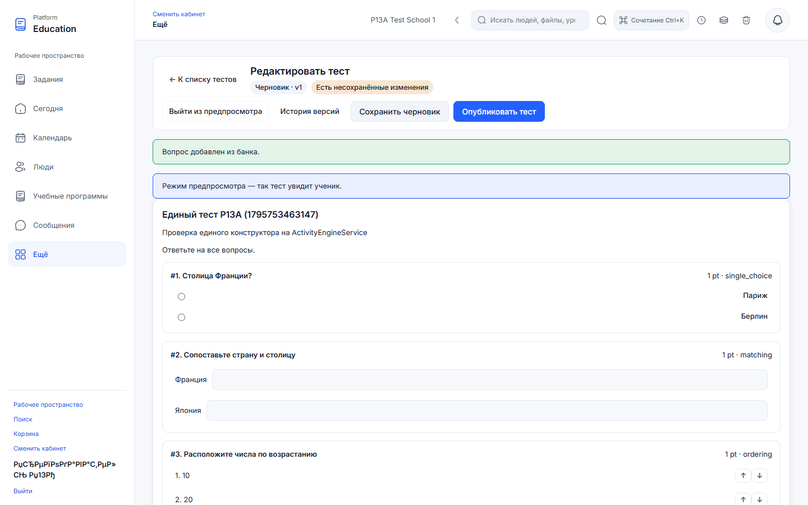
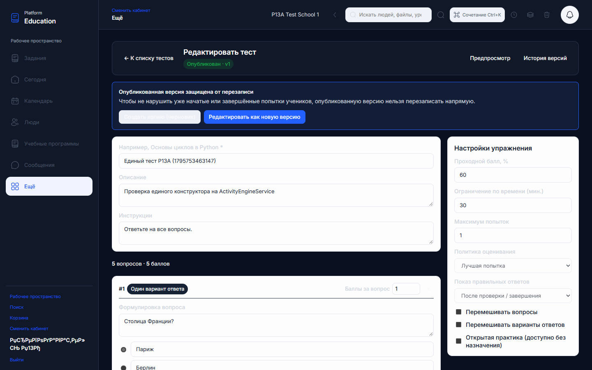
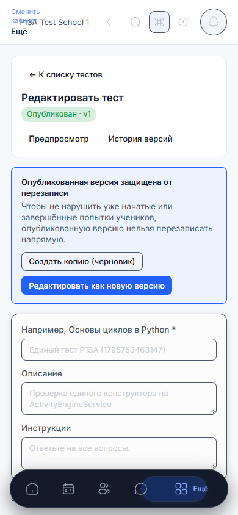

# PLATFORM_13_A — Unified Assessment Constructor Acceptance Report

**VERDICT: READY**

## 1. Что реализовано

### Единый бэкенд-конструктор на базе `ActivityEngineService` (`activity.*`)
- **Каноническое хранилище и жизненный цикл**: Создание, чтение, обновление, публикация, история версий и банк вопросов для тестов (`platform-assessment`) выполняются через `ActivityEngineService` и таблицы `activity.items`, `activity.versions`, `activity.question_bank`.
- **Поддержка всех 8 типов вопросов** в `AssessmentActivityPlugin::validateQuestions` и `AssessmentActivityPlugin::evaluate`:
  - `single_choice` (один правильный ответ)
  - `multi_choice` (несколько правильных ответов)
  - `true_false` (верно / неверно)
  - `short_text` (короткий текст)
  - `long_text` (развёрнутый ответ с ручной проверкой)
  - `numeric` (числовой ответ с погрешностью `tolerance`, учтён в `generateExercise()` и `scoreQuestion()`)
  - `matching` (сопоставление пар `left ↔ right`)
  - `ordering` (упорядочивание элементов)
- **Неизменяемость опубликованных версий**:
  - `ActivityEngineService::updateActivity` блокирует тихую перезапись `PUBLISHED` активности (`409 published_version_immutable`), разрешая только переход статуса (`CLOSED`/`ARCHIVED`) или публикацию новой неизменяемой версии (`publish: true` → `version_number + 1`).
  - Добавлен метод `ActivityEngineService::listVersions` и маршрут `GET /api/activity/items/{id}/versions`.
  - В `ActivityEngineService::listQuestionBank` добавлена фильтрация по `type` и `q` (поисковый запрос).
- **Доменный контекст Education и RBAC**:
  - `AssessmentAction` передаёт `AuthenticatedIdentity` в `AssessmentService` после проверки `EducationAccess::scope($identity, $organization, 'education.activities.manage')`.
  - `EducationActivityDomainPolicy::isTeacherInOrg` учитывает также разрешение `education.activities.manage`.

### Единый фронтенд-конструктор (`AssessmentConstructor.vue`)
- Создан единый компонент [`AssessmentConstructor.vue`](../../apps/frontend/src/modules/activity/AssessmentConstructor.vue), используемый в обеих точках входа:
  - Education: [`AssessmentEditorView.vue`](../../apps/frontend/src/modules/education/assessment/AssessmentEditorView.vue) (`/assessments/new`, `/assessments/:id/edit`).
  - Universal Activity Studio: [`ActivityStudioView.vue`](../../apps/frontend/src/modules/activity/ActivityStudioView.vue) (`/activities/studio`, `/activities/studio/:activityId` при `pluginCode === 'platform-assessment'`).
- Визуальные редакторы для всех 8 типов вопросов (без ввода вариантов через запятую).
- Стабильные уникальные идентификаторы вопросов и вариантов (`nextId` с монотонным счётчиком, включая импорт из банка и дублирование вопросов).
- Управление вопросами: добавление, редактирование, дублирование, изменение порядка (`↑`/`↓`), удаление, баллы, пояснения, сохранение в банк и импорт из банка (`QuestionBankDrawer.vue`).
- Предпросмотр теста на базе `AssessmentRunnerPlugin.vue`.
- Настройки, поддерживаемые сервером: проходной балл (%), лимит времени (мин/сек), максимум попыток, политика оценивания (`highest`, `latest`, `average`), политика раскрытия ответов (`after_grading`, `immediate`, `deadline`, `never`), перемешивание вопросов/вариантов, открытая практика.
- Клиентская и серверная валидация, видимые баннеры ошибок, защита от повторной отправки, предупреждение о несохранённых изменениях (`beforeunload`, `onBeforeRouteLeave`, индикатор), блокировка тихого редактирования опубликованной версии с действиями «Создать копию (черновик)» и «Редактировать как новую версию».
- Полная RU/EN локализация (`education/i18n.ts`, `activityI18n.ts`), поддержка светлой/тёмной темы и мобильного экрана.
- Исправлены маршрут `education-assessment-edit` в `routes.ts` (передача `assessmentId` через `props`) и навигация из `AssessmentListView.vue`.

## 2. Какие дублирующиеся реализации устранены

- **Бэкенд**: Устранена независимая бизнес-логика создания, чтения, обновления, публикации, версионирования и работы с банком вопросов в `AssessmentService` — операции делегированы в `ActivityEngineService`, а валидация вопросов делегирована в `AssessmentActivityPlugin::validateQuestions`.
- **Фронтенд**: Устранён текстовый конструктор вопросов через запятую с захардкоженными английскими подписями в `ActivityStudioView.vue` и отдельный редактор в `AssessmentEditorView.vue` — оба маршрута используют единый `AssessmentConstructor.vue`.

## 3. Что осталось временным для совместимости

- Таблицы `education.assessments`, `education.assessment_versions`, `education.assessment_attempts` и `education.question_bank` сохранены в соответствии с границами этапа.
- `AssessmentService::projectActivityToLegacyAssessment` и `AssessmentService::projectQuestionBankItemToLegacy` выполняют одностороннюю совместимую проекцию из `activity.*` в `education.assessment*` (с сохранением идентичных UUID) для поддержки `StudentAssessmentRunner`, `AssessmentResultView` и существующих сценариев назначений/попыток до этапа `PLATFORM_13_B`.
- `AssessmentService::getAssessment` сохраняет fallback-чтение из `education.assessments` для исторических записей, ещё не перенесённых в `activity.items`.

## 4. Какие файлы изменены

- `apps/backend/src/Activity/Infrastructure/Plugins/AssessmentActivityPlugin.php`
- `apps/backend/src/Activity/Application/ActivityEngineService.php`
- `apps/backend/src/Activity/Api/ActivityAction.php`
- `apps/backend/config/common/activity-routes.php`
- `apps/backend/config/common/di/education.php`
- `apps/backend/src/Education/Api/AssessmentAction.php`
- `apps/backend/src/Education/Application/AssessmentService.php`
- `apps/backend/src/Education/Infrastructure/EducationActivityDomainPolicy.php`
- `apps/backend/tests/Foundation/AssessmentDomainTest.php`
- `apps/frontend/src/modules/activity/AssessmentConstructor.vue` (новый единый компонент)
- `apps/frontend/src/modules/activity/ActivityStudioView.vue`
- `apps/frontend/src/modules/activity/activityApi.ts`
- `apps/frontend/src/modules/activity/activityI18n.ts`
- `apps/frontend/src/modules/education/activityTypes.ts`
- `apps/frontend/src/modules/education/i18n.ts`
- `apps/frontend/src/modules/education/routes.ts`
- `apps/frontend/src/modules/education/assessment/AssessmentEditorView.vue`
- `apps/frontend/src/modules/education/assessment/AssessmentListView.vue`
- `apps/frontend/src/modules/education/assessment/QuestionBankDrawer.vue`
- `apps/frontend/src/modules/education/assessment/AssessmentStudio.spec.ts`

## 5. Какие локальные сценарии реально проверены

1. **Целевые модульные тесты**:
   - Backend PHPUnit: `tests/Foundation/AssessmentDomainTest.php`, `tests/Foundation/ActivityPluginTest.php`, `tests/Foundation/Platform10And11DomainTest.php` — **34 tests, 298 assertions, OK**.
   - Frontend TypeScript: `npx vue-tsc --noEmit -p tsconfig.app.json` — **0 errors**.
   - Frontend Vitest: `src/modules/education/assessment/AssessmentStudio.spec.ts` — **5 tests, passed**.
2. **Локальный стек (Vite `127.0.0.1:5173` + PHP Backend `127.0.0.1:8082` + PostgreSQL, тестовые фикстуры `p13a-teacher@local.test`, `p13a-noauth@local.test`, `P13A Test School 1/2`) через Playwright**:
   - Преподаватель создал тест с вопросами разных типов (`single_choice`, `matching`, `ordering`, `numeric`).
   - Сохранил черновик (`201 Created`), закрыл конструктор и повторно открыл `/assessments/:id/edit` из списка тестов — все данные и вопросы сохранились.
   - Сохранил вопрос в банк вопросов (`201 Created`), импортировал вопрос из банка в тест и проверил режим предпросмотра.
   - Опубликовал тест (`200 OK`), повторно открыл опубликованный тест — отображается баннер неизменяемости опубликованной версии; попытка прямой перезаписи `PUT /api/activity/items/:id` отклонена сервером (`409 published_version_immutable`).
   - Проверена изоляция организаций (запрос с другой организацией → `403`) и ролевых прав (пользователь без `education.activities.manage` → `403`).

### Скриншоты реального конструктора

## 6. Ограничения, остающиеся до PLATFORM_13_B

- `StudentAssessmentRunner` и `AssessmentResultView` продолжают работать со своими текущими эндпоинтами и legacy-таблицами `education.assessment_attempts` (через совместимую проекцию); их перевод на канонический `ActivityEngineService` / `AssessmentRunnerPlugin` относится к следующему этапу (`PLATFORM_13_B`).
- Прямой вызов `/api/activity/*` требует наличия у пользователя RBAC-разрешения `activity.create` / `activity.use` (пользователи Education с `education.activities.manage` без `activity.create` работают через совместимые маршруты `/api/education/assessments*`, которые делегируют в `ActivityEngineService`).
